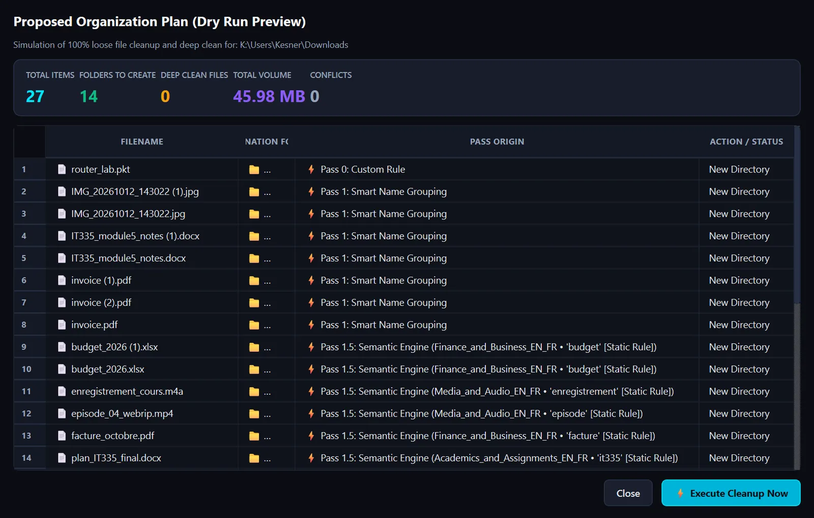
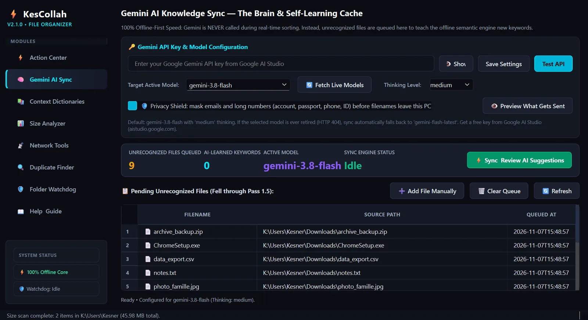
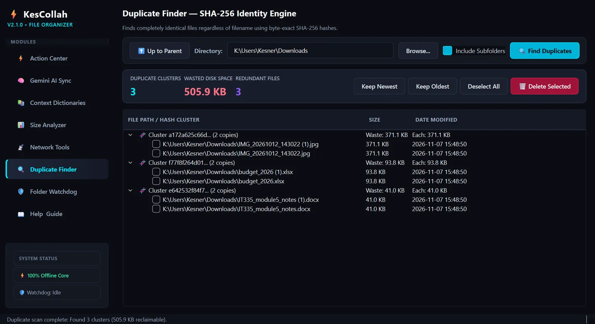

# KesCollah File Organizer

**Zero loose files on Windows, with AI that asks before it acts.**

KesCollah is a Windows desktop app that takes a cluttered Downloads or Desktop folder to zero loose files. Local rules do the sorting. Gemini only suggests categories for the files those rules can't place, and nothing becomes a rule until you approve it. Every job runs as a dry run first, and any operation can be undone.



**[Download the latest Windows build](https://github.com/kescollah/KesCollah-File-Organizer/releases/latest)** · Version 2.1.0

---

## Features

| | |
|---|---|
| **Multi-pass sorting** | Custom rules, smart name grouping, an English and French keyword dictionary, then an extension catch-all. |
| **Dry run and undo** | See every planned move before anything changes. A JSON undo journal can reverse any past operation. |
| **AI with a human in the loop** | Unrecognized filenames are queued. Gemini proposes a category and keyword for each, and you review them before they are saved as rules. |
| **Privacy Shield** | Masks emails and long numbers (account, passport, phone, ID) before any filename is sent to Gemini. File contents are never sent. |
| **Duplicate finder** | Byte-exact SHA-256 matching with a size and header pre-filter, plus keep-newest and keep-oldest helpers. |
| **Folder watchdog** | Sorts new files as they land, using native OS events with a polling fallback. |
| **Size analyzer** | Finds the folders using the most disk space, with breadcrumb navigation. |
| **Passive Wi-Fi scanner** | Lists nearby networks, signal, band, channel and security using `netsh`, on English and French Windows. |

## How sorting works

| Pass | What it does | Example |
|---|---|---|
| **0 · Custom rules** | Your own pattern rules run first. | `*.pkt` → `Networking_Projects/` |
| **1 · Smart name grouping** | Groups related files after stripping copy tags, versions and timestamps. | `invoice (1).pdf`, `invoice (2).pdf` → `invoice/` |
| **1.5 · Semantic engine** | Matches keywords from the built-in dictionary and your AI-learned rules, accent-insensitive, in English and French. | `facture_octobre.pdf` → `Finance_and_Business_EN_FR/` |
| **2 · Extension catch-all** | Anything left is sorted by file type. | `setup_x64.msi` → `Executables_and_Installers/` |

Files that fall through pass 1.5 are added to the Gemini review queue, so the next sync can teach the offline engine a new keyword.

## AI review, with you in control



- Gemini is never called during sorting. Sorting is 100% offline.
- When you choose to sync, only the queued **filenames** are sent, after the Privacy Shield masks personal numbers and emails.
- Each proposal (category and keyword) is shown in a review dialog. Approved keywords are saved to `learned_rules.json`, so similar files are sorted locally next time, without another API call.
- The model and thinking level are configurable. If a model is retired, sync falls back to `gemini-flash-latest`.

## Duplicate finder



## Getting started

### Option 1: Windows executable

Download `KesCollah.exe` from the [latest release](https://github.com/kescollah/KesCollah-File-Organizer/releases/latest) and run it. No Python install is needed. Windows SmartScreen may warn about an unsigned app the first time; choose **More info → Run anyway**.

### Option 2: Run from source

Requires Windows 10 or 11 and Python 3.11 or newer (developed on Python 3.13).

```powershell
git clone https://github.com/kescollah/KesCollah-File-Organizer.git
cd KesCollah-File-Organizer
python -m pip install -r requirements.txt
python main.py
```

To use AI review, get a free Gemini API key from [Google AI Studio](https://aistudio.google.com) and paste it into **Gemini AI Sync → Save Settings**.

### Build the executable

```powershell
python -m pip install pyinstaller
.\build_executable.bat
```

The standalone executable is written to `dist\KesCollah.exe`.

## Where your data lives

Settings, rules and the undo journal are stored in `%USERPROFILE%\.kescollah\`:

| File | Purpose |
|---|---|
| `kescollah_rules.json` | Custom rules (pass 0) |
| `semantic_rules.json` | Built-in keyword dictionary (pass 1.5) |
| `learned_rules.json` | Keywords you approved from Gemini |
| `extension_mapping.json` | Extension catch-all (pass 2) |
| `kescollah_undo.json` | Undo journal |
| `kescollah_settings.json` | Settings and your Gemini API key (stored locally only) |

## Project structure

```
main.py              App entry point (PyQt6)
config.py            Paths, defaults and the built-in dictionary
core/                Sorting engine, Gemini sync, duplicates, size analyzer, watchdog, Wi-Fi scanner
ui/                  Main window, sidebar, views and dialogs
assets/              App icon
KesCollah.spec       PyInstaller build spec
```

## Tech stack

Python · PyQt6 · Gemini REST API (standard library, no SDK) · watchdog · PyInstaller

## Author

Built by [Kesner Morisset](https://kesner-morisset.vercel.app) ([@kescollah](https://github.com/kescollah)). Developed with AI coding agents; architecture decisions, review and testing by the author.
